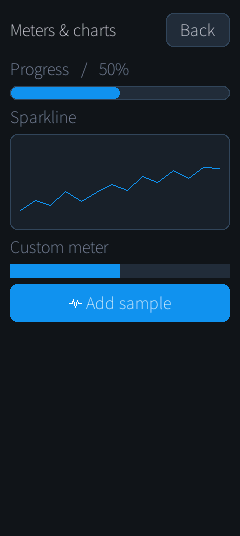
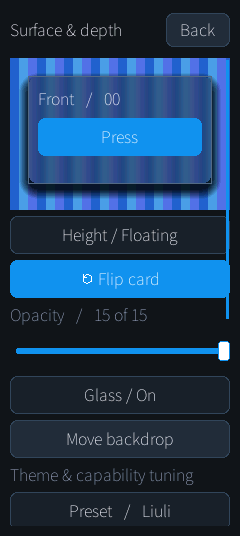

# Widget Demo 全控件演示

解压对应平台的 SDK 后运行 `tools/bin/liuli-widget-demo`，Windows 使用 `tools/bin/liuli-widget-demo.exe`。打开终端打印的网址，浏览器中显示与参考板同尺寸的 240 × 536 页面。程序自带所需字体。可点击、触摸或通过预览器的导航键操作。首页的 Theme 切换浅色和深色，各页的 Back 返回目录。

  

| 页面 | 可以直接尝试的操作 |
|---|---|
| Buttons & sliders | 按按钮计数、用开关禁用或启用按钮、拖动滑块。标签显示点击次数和当前百分比。 |
| Meters & charts | 点击 Add sample，观察进度条、32 点环形缓冲曲线和自绘数值表同步更新。 |
| Tabs & selectors | Mode 页选择互斥项，Value 页按 5 的步长调整数值。切回后保留选项。 |
| Dialogs & toasts | 打开模态确认框，尝试确认、取消和返回。确认后提示条显示两秒，也可单独触发。 |
| Virtual list | 在 1,000 条记录间滚动并点选条目。选中项显示勾号，活动节点随视口有界。 |
| Icon set | 逐项查看全部 11 个命名图标及其按钮状态，点选后显示名称。 |
| Image transforms | 旋转、缩放绘制的 RGB565 指针图像，用滑块调节 16 档透明度，观察裁剪窗口。 |
| Text field | 显示中文、拉丁字母、阿拉伯文和天城文。桌面可使用输入法；实板可用 Compose、Commit、Cancel preedit 和 Backspace 操作同一个单行编辑器。 |
| Surface & depth | 按住 Press 观察卡片投影收缩，释放后恢复。Height 切换表面高度。增强档可翻转卡片、调整整组透明度、切换毛玻璃、移动背后的条纹，并可在下方逐项调整 `ThemePreset`（Liuli/Classic/Industrial）、`Shape`、阴影开关、按压缩放、毛玻璃模糊半径、透色遮罩透明度与圆角焦点框。 |

完整演示采用增强配置，共九页。基础配置可运行八页，Surface & depth 展示零堆投影和按压动效。Shift + 点击桌面预览可查看节点、命中目标和表面效果。导出的输入轨迹可直接交给同一程序。

 

~~~sh
tools/bin/liuli-widget-demo --headless
tools/bin/liuli-widget-demo --screenshots widget-shots
tools/bin/liuli-widget-demo --replay recorded.trace
~~~

无头模式逐页发送指针和按键输入，核对开关禁用、选择、模态返回、提示消失、列表滚动、旋转和文本组合，并将每一次实际呈现的帧与全屏参考绘制比对。它还单独核对首页按钮和紧邻下一行的列表项焦点框，四条边上的每个像素都应保留焦点色。使用 `--port 0` 可为交互模式分配空闲本机端口。

日常开发可运行 `python tools/check-ui.py`，同时执行控件目录和告警产品的无头回归。[离线运行和编写夹具](sdk.md#无人值守的-ui-回归)

从仓库源码启动完整演示：

~~~sh
cargo run -p liuli-widget-demo --features desktop,enhanced
~~~

参考板固件包内的 `widget-demo.bin` 与日常告警程序共用分区表和 LF4 字库。已安装本框架的板子可单独替换应用分区。空白板的完整写入步骤见板级指南。使用 SDK 从源码重建演示固件：

~~~sh
python boards/waveshare-s3-amoled/build.py --profile widget-demo --offline --out target/widget-demo
~~~

## 表面效果的实板基准

在 Waveshare ESP32-S3-Touch-AMOLED-1.91 上，测试固件通过原始指针输入打开演示并翻转卡片。每种模式推进 16 个动画时刻，间隔为 40 ms 的虚拟时间。下表按实测墙钟耗时排序，取第 8、16 帧作为 P50、P95。整帧包含引擎更新、单遍 `RGB565 + A4` 合成与原地模糊，以及片内双缓冲异步 ping-pong QSPI DMA 与 CPU 条带渲染的流水线重叠传输耗时。

| 240 × 536，局部更新 | 整帧 P50 | 整帧 P95 |
|---|---:|---:|
| 翻转，关闭毛玻璃 | 26.91 ms | 38.68 ms |
| 翻转，开启毛玻璃 | 26.87 ms | 41.15 ms |

采用按列透视逆映射、`RGB565 + A4` 紧凑图层、原地环状盒式模糊、背景缓存解耦自身阴影与双缓冲异步 QSPI DMA 后，开启与关闭毛玻璃的整帧中位数从最初的 155.8 ms、62.8 ms 分别降至 26.87 ms、26.91 ms。日常交互固件已恢复并完成首帧 128,640 像素传输（`44.93 ms`）。表中数据截至提交到面板，不含显示端出画延迟。[逐帧串口记录与固件 SHA-256](hardware/widget-effects.log)

用下列命令生成自动基准固件，按板级指南写入后，串口会依次输出两组带有 `sample=5`、`sample=6` 的记录。日常版本可用本页上方的常规构建命令生成。

~~~sh
python boards/waveshare-s3-amoled/build.py --profile widget-demo --effects-benchmark --offline --out target/effects-bench
~~~
