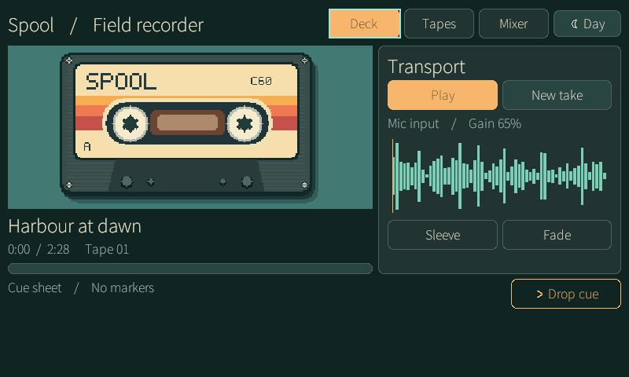
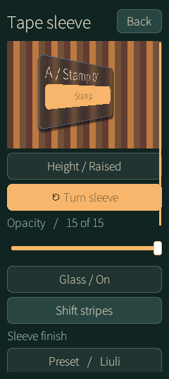

# Spool 便携录音台 · Widget Demo

Spool 用一盘磁带串起整套控件。打开 **Tapes** 选一条素材，录音台会载入它的名字、时长和波形。点 **Play** 开始走带，再去 **Mixer → Routing** 换输入源、调增益。回到 **Deck** 可以看到新设置，播放位置也会继续前进。

在解压的 SDK 里运行 `tools/bin/liuli-widget-demo`，Windows 使用同名 `.exe`。打开终端打印的网址。默认使用 240 × 536 的单列界面，`--size 800x480` 切换横屏双栏。**Day / Night** 切换配色，**Back** 回到上一级。预览器支持原始指针、导航键和 Shift + 点选检查器。

## 录一条新素材

1. 在 **Deck → New take** 调整输入增益，点 **Start recording**。计时和输入电平随引擎时钟推进。启用 Cue markers 后可以在录制中打点。
2. 点 **Finish take** 停表，再选 **Save take** 或 **Discard**。在确认框内按返回可继续录制。保存后回到 Deck，新录音已经装载。
3. 打开 **Tapes**，新录音在库顶。点选任意素材后回到磁带库，滚动位置与选中行会恢复。

这是 UI 演示。音频信号由模型生成。1,000 条预置素材按需构建，每次运行还能保留最近八条新录音的元数据。重启会开始新的会话。

  

| 操作位置 | 在应用里能做什么 |
|---|---|
| Deck → Fade | 同时预览播放位置与三次缓出的淡入包络，可暂停、续播或倒带。选择 0.6、1.2 或 2.4 秒，下一次在 Deck 开始播放时会使用这个淡入时长。 |
| Deck → Sleeve | 给磁带套盖章，切换悬浮高度和饰面。增强档可翻面、改变整层透明度、调整毛玻璃与底纹。 |
| Mixer → Routing / Line check | 选择 Mic、Line 或 Aux，编辑输入增益，发测试音查看信号历史和电平。 |
| Mixer → Deck artwork | 调整磁带图案的旋转、透明度和缩放，主屏同步使用这组设置。 |
| Tapes → Cue stamps | 从 11 种图章中选择打点标记。Mixer 可开关打点，横屏主台会显示最近一次标记和时间。 |
| Tapes → Notebook | 增强档支持多文字系统的笔记编辑、组合输入、快捷标签和房间底噪记录清单。 |

  

~~~sh
tools/bin/liuli-widget-demo --headless
tools/bin/liuli-widget-demo --screenshots widget-shots
tools/bin/liuli-widget-demo --replay recorded.trace
~~~

无头模式用原始触摸录制、保存、重新载入和播放，验证停表、列表偏移与焦点恢复；也覆盖界面切换、逐帧像素对照、选中框、翻转、文本组合和可取消动效。使用 `--port 0` 可为交互模式分配空闲本机端口。

日常开发可运行 `python tools/check-ui.py`，同时执行控件目录和告警产品的无头回归。[离线运行和编写夹具](sdk.md#无人值守的-ui-回归)

从仓库源码启动完整演示：

~~~sh
cargo run -p liuli-widget-demo --features desktop,enhanced
~~~

参考板固件包内的 `widget-demo.bin` 与日常告警程序共用分区表和 LF4 字库。已安装本框架的板子可单独替换应用分区。空白板的完整写入步骤见板级指南。使用 SDK 从源码重建演示固件：

~~~sh
python boards/waveshare-s3-amoled/build.py --profile widget-demo --offline --out target/widget-demo
~~~

## 早期表面效果的实板基准

下表记录 2026-11-24 的演示固件。在 Waveshare ESP32-S3-Touch-AMOLED-1.91 上，测试固件通过原始指针输入打开演示并翻转卡片。每种模式推进 16 个动画时刻，间隔为 40 ms 的虚拟时间。下表按实测墙钟耗时排序，取第 8、16 帧作为 P50、P95。整帧包含引擎更新、单遍 `RGB565 + A4` 合成与原地模糊，以及片内双缓冲异步 ping-pong QSPI DMA 与 CPU 条带渲染的流水线重叠传输耗时。

| 240 × 536，局部更新 | 整帧 P50 | 整帧 P95 |
|---|---:|---:|
| 翻转，关闭毛玻璃 | 26.91 ms | 38.68 ms |
| 翻转，开启毛玻璃 | 26.87 ms | 41.15 ms |

采用按列透视逆映射、`RGB565 + A4` 紧凑图层、原地环状盒式模糊、背景缓存解耦自身阴影与双缓冲异步 QSPI DMA 后，开启与关闭毛玻璃的整帧中位数从最初的 155.8 ms、62.8 ms 分别降至 26.87 ms、26.91 ms。日常交互固件已恢复并完成首帧 128,640 像素传输（`44.93 ms`）。表中数据截至提交到面板，不含显示端出画延迟。[逐帧串口记录与固件 SHA-256](hardware/widget-effects.log)

用下列命令生成自动基准固件，按板级指南写入后，串口会依次输出两组带有 `sample=5`、`sample=6` 的记录。日常版本可用本页上方的常规构建命令生成。

~~~sh
python boards/waveshare-s3-amoled/build.py --profile widget-demo --effects-benchmark --offline --out target/effects-bench
~~~
