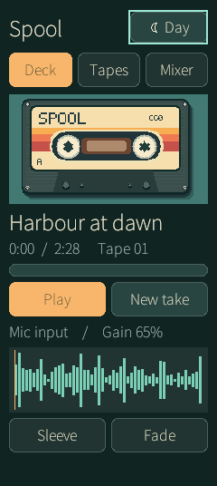
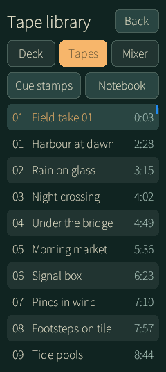
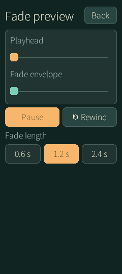

# Widget Demo 功能展台

运行 SDK 中的 `tools/bin/liuli-widget-demo`，打开终端打印的预览地址。六个页面共用库里的 Tabs。横屏和竖屏使用同一份页面声明，标题和语言、主题操作按文字测量。空间紧张时，页签栏移到下一行，页签最多换成两行，仍放不下即可横滚。顶部页签用跟随标签宽度的下划线标明活动页，切页时下划线平移。控件样例页使用带圆角的填充选中态和淡变。两处都通过主题配置库里的 Tabs。

| 页面 | 可以动手验证的功能 |
|---|---|
| Overview | 调整负载，观察温度仪表、渐变、加载动画和富文本。竖屏向上滑动可看到后续示例。 |
| Forms | 点击复选框、单选项和滚轮，编辑多行文字，从下拉选择器切换驱动。竖屏可纵向滚动。 |
| Charts | 追加或暂停采样，观察柱状图和折线图。竖屏向上滑到数据表，再左右拖动查看全部四列，点行即可选中。 |
| Layout | 比较六种主轴对齐方式、点选八个网格项，用手指或箭头横滚卡片。竖屏继续向上滑动可到转场预览。 |
| Motion | 在 Standard、Snappy、Reduced 之间切换，对照内置开关与自绘表头。比较主题时长与局部 480 ms 覆盖，重播 16 种转场，拖动滑块观察进度条。 |
| Widgets | 在第二组顶部 Tabs 中选择调节、列表、图形、输入或按钮。 |

竖屏回归轨迹 `portrait-catalog.trace` 从首页开始，向上滑到转场按钮，在表单中打开诊断日志并插入新行，拖动表格查看最后一列并选择最后一行，最后在布局页调整对齐并切换动画预设。

### 控件页

| 分组 | 可以动手验证的功能 |
|---|---|
| 调节 | 拖动弧形旋钮、有刻度的滑块或数值编辑器，观察同一数值和趋势线。用选择器切换预设，点带数值徽标的按钮打开确认框，确认后显示定时提示条。 |
| 列表 | 拖动 1,000 条有稳定标识的记录，点一条查看编号。可在模拟器检查器中观察条目随视口创建。 |
| 图形 | 旋转 RGB565 图片，调节缩放和透明度。向上滑动可看到圆角悬浮卡片，里面有三次贝塞尔心形与描边，渐隐覆盖图案和说明文字。增强档支持双触点平移、捏合、旋转，以及投影和毛玻璃合成；基础档可使用单指控制并查看抬升表面。 |
| 输入 | 在可定位光标的输入框中使用屏幕键盘或宿主文本输入。键盘支持英文、数字、符号、拼音和 T9。演示词典包含“中文、琉璃、输入、动效、图表”。增强档还能切换阿拉伯文、天城文和混排塑形样本。 |
| 按钮 | 操作六种按钮变体，比较禁用态，点选全部 11 种内置图标。缩小视口时按钮与图标会换行。 |

从源码运行横屏、竖屏和固定轨迹回放：

~~~sh
python tools/build-ui.py --app apps/liuli-widget-demo/Cargo.toml --app-features desktop,enhanced --action run -- --bin liuli-widget-demo --release
python tools/build-ui.py --app apps/liuli-widget-demo/Cargo.toml --app-features desktop,enhanced --action run -- --bin liuli-widget-demo --release -- --size 240x536
python tools/build-ui.py --app apps/liuli-widget-demo/Cargo.toml --app-features desktop,enhanced --action run -- --bin liuli-widget-demo --release -- --replay apps/liuli-widget-demo/tests/fixtures/h743-style.trace --scanout target/theme.rgb565
~~~

动效页的竖屏轨迹为 `portrait-motion.trace`。控件页的横竖屏轨迹分别为 `h743-widgets.trace` 和 `portrait-widgets.trace`，覆盖顶部切页、预设确认、列表滚动、图形操作、按钮与软键盘输入。从解压的 SDK 运行时，把命令中的程序换成 `tools/bin/liuli-widget-demo`，轨迹路径从 `liuli-widget-demo/tests/fixtures/` 开始。H743 可通过 J-Link 注入同一条横屏轨迹，并与桌面输出比对。

~~~sh
python boards/fk743m2-iit6/jlink.py --speed 12000 --themed-motion apps/liuli-widget-demo/tests/fixtures/h743-style.trace target/theme.rgb565
python tools/build-ui.py --app apps/liuli-widget-demo/Cargo.toml --app-features desktop,enhanced --action run -- --bin liuli-widget-demo --release -- --replay apps/liuli-widget-demo/tests/fixtures/h743-widgets.trace --scanout target/widgets.rgb565
python boards/fk743m2-iit6/jlink.py --speed 12000 --widget-samples apps/liuli-widget-demo/tests/fixtures/h743-widgets.trace target/widgets.rgb565
~~~

布局页的 `h743-strip-fling.trace` 在横滚区中段松手。下面的实板回放自动注入触摸，从 LTDC 帧缓冲采样松手后的卡片边缘，并将停止后的内容区与桌面逐像素比较。

~~~sh
python tools/build-ui.py --app apps/liuli-widget-demo/Cargo.toml --app-features desktop,enhanced --action run -- --bin liuli-widget-demo --release -- --replay apps/liuli-widget-demo/tests/fixtures/h743-strip-fling.trace --scanout target/fling.rgb565
python boards/fk743m2-iit6/jlink.py --speed 12000 --strip-fling apps/liuli-widget-demo/tests/fixtures/h743-strip-fling.trace target/fling.rgb565
~~~

图形页的 `h743-composition.trace` 从首页进入展台，滑动图形页，使渐隐卡片完整进入视口。桌面回放逐帧核对增量输出和整屏参考渲染。H743 使用同一轨迹，比对停止后的页签和内容区域。

~~~sh
python tools/build-ui.py --app apps/liuli-widget-demo/Cargo.toml --app-features desktop,enhanced --action run -- --bin liuli-widget-demo --release -- --size 800x480 --replay apps/liuli-widget-demo/tests/fixtures/h743-composition.trace --scanout target/h743-composition.rgb565
python boards/fk743m2-iit6/jlink.py --speed 12000 --widget-samples apps/liuli-widget-demo/tests/fixtures/h743-composition.trace target/h743-composition.rgb565
~~~

2026-11-28，FK743M2-IIT6 使用 ST HAL+LL 增强固件完成上述卡片轨迹，LTDC 帧缓冲前 430 行的 344,000 个 RGB565 像素与桌面一致。底部 50 行包含随板上时钟变化的统计信息。固件 CRC32 为 `e0383927`，桌面整帧参考文件的 SHA-256 为 `e2eb9f73c8f560ac17d5a021e8010c4aff06fb093d4a7df375c71ce2d4b6c377`。

调节页的 `h743-focus-shapes.trace` 用触摸打开控件页，再用前进和后退导航在旋钮、滑块间切换。结束时焦点回到旋钮，手柄位置和页签选择保留。模拟器逐帧验证重绘，H743 通过 SWD 向相同的输入入口注入导航，读取 LTDC 帧缓冲比对页签及内容区。

~~~sh
python tools/build-ui.py --app apps/liuli-widget-demo/Cargo.toml --app-features desktop,enhanced --action run --locked --offline -- --bin liuli-widget-demo --release -- --size 800x480 --replay apps/liuli-widget-demo/tests/fixtures/h743-focus-shapes.trace --scanout target/h743-focus-shapes.rgb565
python boards/fk743m2-iit6/jlink.py --speed 12000 --widget-samples apps/liuli-widget-demo/tests/fixtures/h743-focus-shapes.trace target/h743-focus-shapes.rgb565
~~~

2026-11-28，FK743M2-IIT6 的 ST HAL+LL 增强固件 `f41f7e8a`（CRC32）完成这条轨迹。LTDC 前 430 行共 344,000 个 RGB565 像素与桌面一致，底部 50 行为实时统计区。桌面整帧参考的 SHA-256 为 `9856c140c66fd01c5660b8594901016fac09bacc9575d0fa4aa62a50757b942c`。

首屏回归 `startup-focus.trace` 依次覆盖冷启动、向前导航、向后导航、按下空白区和松手。2026-11-28 在 FK743M2-IIT6 的 ST HAL+LL 增强档 Widget Demo（固件 CRC32 `a8053f03`）上验证。五个检查点分别对照整条 800×48 顶栏，均与桌面一致。结束后板子复位回到触摸首页。

~~~sh
python tools/build-ui.py --app apps/liuli-widget-demo/Cargo.toml --app-features desktop,enhanced --action build --locked --offline -- --bin liuli-widget-demo --release
python boards/fk743m2-iit6/jlink.py --speed 12000 --startup-focus target/release/liuli-widget-demo.exe
~~~

## Spool 便携录音台

使用 `--studio` 打开这个独立产品风格的例子。

Spool 用一盘磁带串起整套控件。打开 **Tapes** 选一条素材，录音台会载入它的名字、时长和波形。点 **Play** 开始走带，再去 **Mixer → Routing** 换输入源、调增益。回到 **Deck** 可以看到新设置，播放位置也会继续前进。


在解压的 SDK 里运行 `tools/bin/liuli-widget-demo --studio`，Windows 使用同名 `.exe`。打开终端打印的网址。默认使用 240 × 536 的单列界面，`--size 800x480` 切换横屏双栏。**Day / Night** 切换配色，**Back** 回到上一级。预览器支持原始指针、导航键和 Shift + 点选检查器。

## 录一条新素材

1. 在 **Deck → New take** 调整输入增益，点 **Start recording**。计时和输入电平随引擎时钟推进。启用 Cue markers 后可以在录制中打点。
2. 点 **Finish take** 停表，再选 **Save take** 或 **Discard**。在确认框内按返回可继续录制。保存后回到 Deck，新录音已经装载。
3. 打开 **Tapes**，新录音在库顶。点选任意素材后回到磁带库，滚动位置与选中行会恢复。

这是 UI 演示。音频信号由模型生成。1,000 条预置素材按需构建，每次运行还能保留最近八条新录音的元数据。重启会开始新的会话。

  

| 操作位置 | 在应用里能做什么 |
|---|---|
| Deck → Fade | 同时预览播放位置与三次缓出的淡入包络，可暂停、续播或倒带。选择 0.6、1.2 或 2.4 秒，下一次在 Deck 开始播放时会使用这个淡入时长。 |
| Deck → Sleeve | 给磁带套盖章，切换悬浮高度和饰面。增强档可翻面、改变整层透明度、调整毛玻璃与底纹。 |
| Mixer → Routing / Line check | 选择 Mic、Line 或 Aux，编辑输入增益，发测试音查看信号历史和电平。 |
| Mixer → Deck artwork | 调整磁带图案的旋转、透明度和缩放，主屏同步使用这组设置。 |
| Tapes → Cue stamps | 从 11 种图章中选择打点标记。Mixer 可开关打点，横屏主台会显示最近一次标记和时间。 |
| Tapes → Notebook | 增强档支持多文字系统的笔记编辑、组合输入、快捷标签和房间底噪记录清单。 |

  

~~~sh
tools/bin/liuli-widget-demo --studio --headless
tools/bin/liuli-widget-demo --studio --screenshots widget-shots
tools/bin/liuli-widget-demo --studio --replay recorded.trace
~~~

无头模式用原始触摸录制、保存、重新载入和播放，验证停表、列表偏移与焦点恢复；也覆盖界面切换、逐帧像素对照、选中框、翻转、文本组合和可取消动效。使用 `--port 0` 可为交互模式分配空闲本机端口。

日常开发可运行 `python tools/check-ui.py`，同时执行控件目录和告警产品的无头回归。[离线运行和编写夹具](sdk.md#无人值守的-ui-回归)

从仓库源码启动录音台：

~~~sh
python tools/build-ui.py --app apps/liuli-widget-demo/Cargo.toml --app-features desktop,enhanced --action run -- --bin liuli-widget-demo -- --studio
~~~

参考板固件包内的 `widget-demo.bin` 与日常告警程序共用分区表。功能展台使用随应用链接的两档 LF4 字库。已安装本框架的板子可单独替换应用分区。空白板的完整写入步骤见板级指南。使用 SDK 从源码重建演示固件：

~~~sh
python boards/waveshare-s3-amoled/build.py --profile widget-demo --offline --out target/widget-demo
~~~

## 早期表面效果的实板基准

下表记录 2026-11-24 的演示固件。在 Waveshare ESP32-S3-Touch-AMOLED-1.91 上，测试固件通过原始指针输入打开演示并翻转卡片。每种模式推进 16 个动画时刻，间隔为 40 ms 的虚拟时间。下表按实测墙钟耗时排序，取第 8、16 帧作为 P50、P95。整帧包含引擎更新、单遍 `RGB565 + A4` 合成与原地模糊，以及片内双缓冲异步 ping-pong QSPI DMA 与 CPU 条带渲染的流水线重叠传输耗时。

| 240 × 536，局部更新 | 整帧 P50 | 整帧 P95 |
|---|---:|---:|
| 翻转，关闭毛玻璃 | 26.91 ms | 38.68 ms |
| 翻转，开启毛玻璃 | 26.87 ms | 41.15 ms |

采用按列透视逆映射、`RGB565 + A4` 紧凑图层、原地环状盒式模糊、背景缓存解耦自身阴影与双缓冲异步 QSPI DMA 后，开启与关闭毛玻璃的整帧中位数从最初的 155.8 ms、62.8 ms 分别降至 26.87 ms、26.91 ms。日常交互固件已恢复并完成首帧 128,640 像素传输（`44.93 ms`）。表中数据截至提交到面板，不含显示端出画延迟。[逐帧串口记录与固件 SHA-256](hardware/widget-effects.log)

用下列命令生成自动基准固件，按板级指南写入后，串口会依次输出两组带有 `sample=5`、`sample=6` 的记录。日常版本可用本页上方的常规构建命令生成。

~~~sh
python boards/waveshare-s3-amoled/build.py --profile widget-demo --effects-benchmark --offline --out target/effects-bench
~~~

## H743 动画展台

进入「网格布局」，用底部左右箭头切换 16 种动效，点 Replay 重播。桌面可运行同一个 800×480 应用：

```sh
python tools/build-ui.py --app apps/liuli-widget-demo/Cargo.toml --app-features desktop,enhanced --action run -- --bin liuli-widget-demo --release -- --showcase
```

以下命令用原始触摸和固定时钟回放切页、切到 Flip 和重播，并导出桌面 RGB565 参考帧。H743 上装入增强档 `--showcase` 固件后，第二条命令通过 J-Link 注入触摸并核对 LTDC 帧缓冲。指定多个探头时用 `--serial` 选择目标。

```sh
python tools/build-ui.py --app apps/liuli-widget-demo/Cargo.toml --app-features desktop,enhanced --action run -- --bin liuli-widget-demo --release -- --showcase --replay apps/liuli-widget-demo/tests/fixtures/h743-motion.trace --scanout target/motion-flip.rgb565
python boards/fk743m2-iit6/jlink.py --speed 12000 --motion-gallery target/motion-flip.rgb565
```
